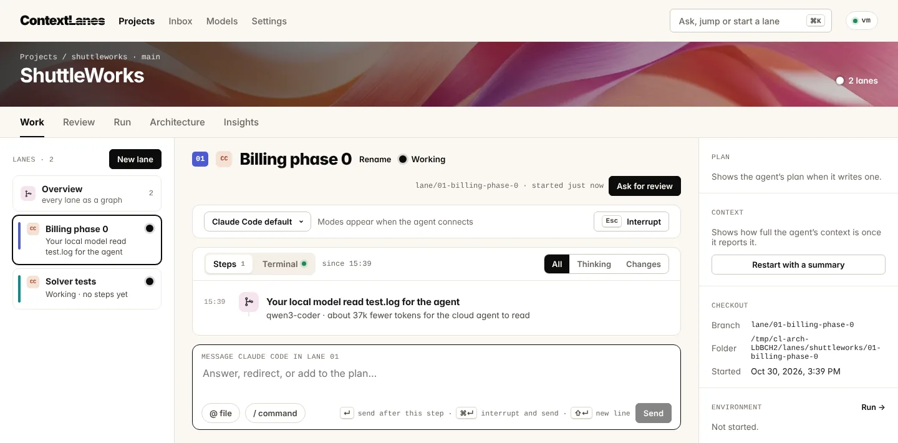

# ContextLanes

Run several coding agents at once, each in its own lane, on a Linux machine that stays on. Steer them from your browser, phone or terminal, review their work with evidence, and merge.



- **Lanes.** Each agent gets its own branch, checkout, terminal and running copy of your app, and keeps going when you close your laptop.
- **One inbox.** Questions and permission requests from every lane in one place, answerable from your phone. Agents never approve themselves.
- **Review with evidence.** Checks, before and after screenshots, the plan and the diff, then merge.
- **Your agents.** Claude Code, Codex, OpenCode and other [ACP](https://agentclientprotocol.com) agents, each with its own login.
- **Architecture.** A map of your code from [CodeGraph](https://github.com/colbymchenry/codegraph) shows where lanes work and warns before two collide.
- **Local models.** Ollama or llama.cpp take small jobs (reading logs, module briefs, insights) off the cloud agents.
- **Self-hosted.** The daemon listens on 127.0.0.1 only; reach it through Tailscale or an SSH tunnel. Lane commands run in a sandbox.

## Requirements

Linux with a systemd user session, Node 22.13 or newer (24 recommended), git, tmux, bubblewrap and python3. Tailscale is optional.

## Install

```sh
curl -fsSL https://raw.githubusercontent.com/wongywrongy/ContextLane/main/install.sh | sh
contextlanes setup
```

`setup` prints a one-time sign-in link and a QR code. Open it, then connect an agent, add a project and start a lane. If the machine should keep lanes running after you log out: `sudo loginctl enable-linger "$USER"`.

## Update

```sh
contextlanes update             # newest version; lanes keep running
contextlanes update --check     # list what is new
contextlanes update --rollback  # back one version
```

Each version is built beside the running one and the database is copied first. If the new version does not start, it switches back by itself.

## Use

```sh
contextlanes lane start <project> "Add a health check"   # or New lane in the browser
contextlanes inbox                                       # what waits on you
contextlanes term <project>/01                           # the lane's shell (tmux)
contextlanes help
```

Settings live in `~/.config/contextlanes/config.toml`, data in `~/.local/share/contextlanes`. Logs: `journalctl --user -u contextlanes`.

## Docs

- [Recipes](docs/RECIPES.md): run your app in each lane with `.contextlanes.json`
- [Architecture](docs/ARCHITECTURE.md): processes, data and security
- [Design](docs/DESIGN.md): principles, words and the visual system
- [Developing](docs/DEVELOPING.md): build, test and run from source
- [Brief](docs/BRIEF.md) and [implementation plan](docs/IMPLEMENTATION.md)
