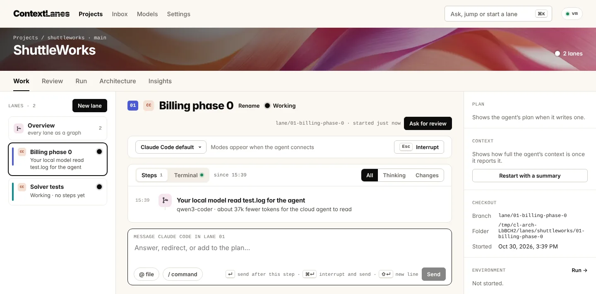

# ContextLanes

Give every coding task its own lane: a branch and checkout, a terminal that keeps running, a copy of your app on its own ports, and a link to open it from any device. Run Claude Code or Codex in a lane, or your own agent in your own checkout; either way it drives the lane with the `contextlanes` command. ContextLanes is one more service on a machine that stays on, behind the reverse proxy you already run.



- **Lanes.** Own branch, checkout, tmux terminal and running app per task; several at once, and they keep going when you close your laptop.
- **Links that work.** Every service gets `https://<service>-<n>-<project>.<your domain>`, known before it starts and passed to it as `$LANE_URL`. One wildcard entry in your proxy covers every lane.
- **Made for agents.** `contextlanes app start`, `contextlanes url`, `contextlanes logs`, all with `--json` and exit codes an agent can act on. Agents are told about them when a lane starts.
- **You decide.** Questions and permission requests from every lane in one inbox, answerable from your phone. New or changed recipes run only after you approve them. Agents never approve themselves.
- **The web app only shows and asks.** It is a viewer for every lane plus those two decisions. Everything that changes a lane is a `contextlanes` command, so an agent can do whatever you can, and a stolen browser session cannot start, message or delete anything.
- **Self-hosted and confined.** The API listens on 127.0.0.1 only. Agents and lane services run in a bubblewrap sandbox that cannot see ContextLanes' own data.

## Run it

**On one machine, no setup.** Links are `http://web-01-shop.localhost:4601` and open in a browser on that machine.

**Behind your reverse proxy.** Add `*.root.example.dev` → port 4601 to Nginx Proxy Manager, Caddy or Traefik, set `[previews] domain = "root.example.dev"`, and open lanes from anywhere at `https://lanes.root.example.dev`. See [docs/PROXY.md](docs/PROXY.md).

**On a tailnet without a domain.** `[previews] mode = "serve"` uses Tailscale Serve, one HTTPS port per service.

## Install

On the machine itself: Linux or macOS with Node 22.13 or newer (24 recommended), git, tmux and python3. On Linux, bubblewrap confines agents (`sudo apt install bubblewrap`).

```sh
curl -fsSL https://raw.githubusercontent.com/wongywrongy/ContextLane/main/install.sh | sh
```

`contextlanes` works straight away. To open the web page, sign that browser in once with `contextlanes setup`; it stays signed in as long as you keep using it.

With a systemd user session the installer runs ContextLanes as a user service; elsewhere it installs the command, and you run `contextlanes daemon` under whatever keeps processes alive on your machine.

On macOS, where bubblewrap does not exist, agents start only after you choose to run them unconfined: `[sandbox] mode = "off"` in `~/.config/contextlanes/config.toml`.

### Docker (v4, in progress)

The planned way to run ContextLanes is Docker: a small control service and one container per lane, built from the project's own `devcontainer.json` ([docs/V4.md](docs/V4.md)). **Only phase 2 of 5 is written: projects, branches and `doctor` work in Docker; lanes do not yet** (`contextlanes new` answers `not_yet`). For lanes, use the host install above for now. Phase 2 has not yet been run on a real Docker host.

```sh
git clone https://github.com/wongywrongy/ContextLane.git /opt/stacks/contextlanes
cd /opt/stacks/contextlanes
docker compose up -d --build   # nothing to fill in; data/config.toml is written with defaults
./install-command              # puts contextlanes in ~/.local/bin (as root: /usr/local/bin)
cd ~/code/your-repository
contextlanes add
contextlanes projects
contextlanes doctor
```

- The control container mounts `./data` and the Docker socket, and none of your folders. Git on a project runs in a short-lived helper container that mounts only that project, as the folder's owner, with no network.
- It holds the Docker socket, which is root-equivalent on the host. Only it has the socket; helpers and lanes never do.
- Only the preview router (port 4601, on 127.0.0.1) is published. The API (4600) answers only on the private `contextlanes` network.
- `contextlanes` on the host is a small script that runs the command in the container with `docker exec` and passes the folder you are in as text. Run `contextlanes add` in the repository's top folder (the one with `.git`).
- A container already called `contextlanes` from an older stack stops `docker compose up`; compose never takes it over. Look at it with `docker inspect contextlanes` and remove or rename it yourself.
- `scripts/v4-check/phase2.sh <repository>` brings the stack up and checks all of the above.

## Use

A **project** is a repository folder you have added. A **lane** is one task inside a project: its own branch, checkout, terminal and copy of the app.

```sh
cd ~/code/shop
contextlanes                     # the menus: Projects → this project's lanes → one lane. Esc goes back a step
```

Or type the commands:

```sh
contextlanes add                 # make this folder a project (once)
contextlanes projects            # every project and how many lanes it has

contextlanes claude              # Claude Code in a new lane of this project (or: contextlanes codex)
contextlanes new "Add a health check"            # a lane for this project; from anywhere: contextlanes new shop "…"
contextlanes new "Finish it" --branch feature/x  # work on a branch that already exists, instead of a new one
contextlanes new "Try the app" --no-agent        # no agent: the checkout, your own shell and the app
contextlanes list                # this machine's open lanes and what they wait on

contextlanes app start           # inside a lane: start the app from .contextlanes.json and wait until it is healthy
contextlanes url                 # its link
contextlanes logs web -n 50
contextlanes send 1 "Use the v2 endpoint"        # a message for lane 1's agent
contextlanes open 1              # your terminal in lane 1
contextlanes delete 1            # stop and delete it
contextlanes inbox               # what waits on you, and answer it
contextlanes agent-notes         # what to put in AGENTS.md so any agent uses this
```

**Branches.** By default a lane gets a new branch of its own (`lane/01-add-a-health-check`) from the project's default branch, so several lanes never share one. To have a lane work on a branch you already have, pass `--branch <name>` (or choose it in the menu); it is checked out in the lane's own folder, so it cannot also be open in your main checkout. `--here` skips all of that and works in the current checkout on whatever branch it is on.

A lane started with `contextlanes claude` or `contextlanes codex` runs its agent in the sandbox. A `--no-agent` lane is your own shell: its services are still confined, but anything you start in that shell yourself, another agent included, runs with your access.

In a terminal, a command with something missing (`contextlanes new`, `contextlanes delete`, `contextlanes send`) asks for it, and every list has a way back. Agents, scripts and `--json` are never asked anything.

There is one word for each action and no second spelling. Inside a project folder a lane is just its number; anywhere else write `shop/01`. `contextlanes help` lists everything.

Add `--json` to any command. Exit codes: 0 done, 1 failed, 2 wrong usage, 3 ContextLanes not reachable, 4 waiting on you (a recipe to approve).

What a lane runs comes from `.contextlanes.json` in your repository: see [docs/RECIPES.md](docs/RECIPES.md).

## For agents

Paste this into a project's `AGENTS.md` or `CLAUDE.md` (it is also what `contextlanes agent-notes` prints), so agents you run yourself use lanes too:

```md
## ContextLanes

This checkout is a ContextLanes lane: its own branch, its own copy of the app on its own ports, and a link for each service. Use the `contextlanes` command; inside a lane it already knows which lane you are in. Add --json to any command for machine-readable output.

- `contextlanes app status` — services, their state, port and link
- `contextlanes app start` — start the app from the recipe (.contextlanes.json) and wait until it is healthy or failed; on failure it prints the logs
- `contextlanes app restart [service]`, `contextlanes app stop`
- `contextlanes logs <service> [-n 100]` — recent log lines
- `contextlanes url [service]` — the service's link, and nothing else (default service: web)
- `contextlanes recipe` — the recipe, its hash and whether it is approved

Services get `$PORT` and must listen on 127.0.0.1 (`$HOST`). They also get `$LANE_URL` and `$LANE_HOSTNAME` (their own link), and `$LANE_URL_<NAME>` for every service, usable in the recipe's commands and env values.

Exit codes: 0 done, 1 failed, 2 wrong usage, 3 ContextLanes not reachable, 4 waiting on the owner. Exit 4 means the recipe is new or changed and only the owner can approve it: say so, and continue with work that does not need the app. Never try to approve it yourself.
```

## More, when you want it

Review with checks and screenshots, the code map and Architecture page, Insights, local-model helpers, sub-lanes, hand-off, schedules and ACP agents (OpenCode and others) are built but off. Turn one on in `~/.config/contextlanes/config.toml`, for example `[features] review = true`, and restart. The list is in [docs/V3.md](docs/V3.md).

## Update

```sh
contextlanes update             # newest version; lanes keep running
contextlanes update --check     # list what is new
contextlanes update --rollback  # back one version
```

## Docs

- [Proxy](docs/PROXY.md): one wildcard entry in Nginx Proxy Manager, Caddy or Traefik
- [Recipes](docs/RECIPES.md): run your app in each lane with `.contextlanes.json`
- [v3](docs/V3.md): what ContextLanes is now, and why
- [v4](docs/V4.md): where it is going: one container per lane
- [Architecture](docs/ARCHITECTURE.md): processes, data and security
- [Developing](docs/DEVELOPING.md): build, test and run from source
- [Design](docs/DESIGN.md), [Brief](docs/BRIEF.md) and [implementation log](docs/IMPLEMENTATION.md)
