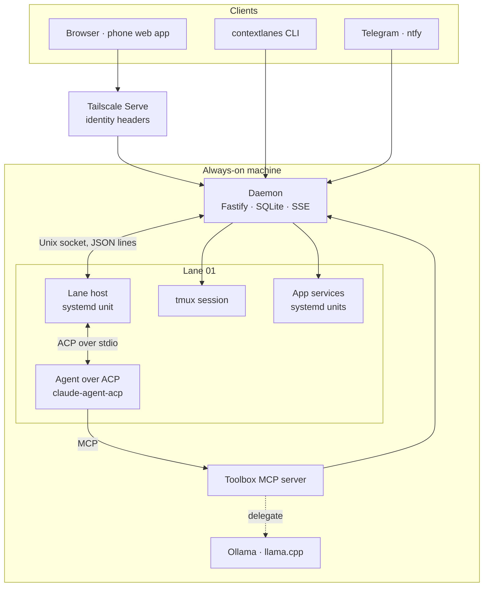
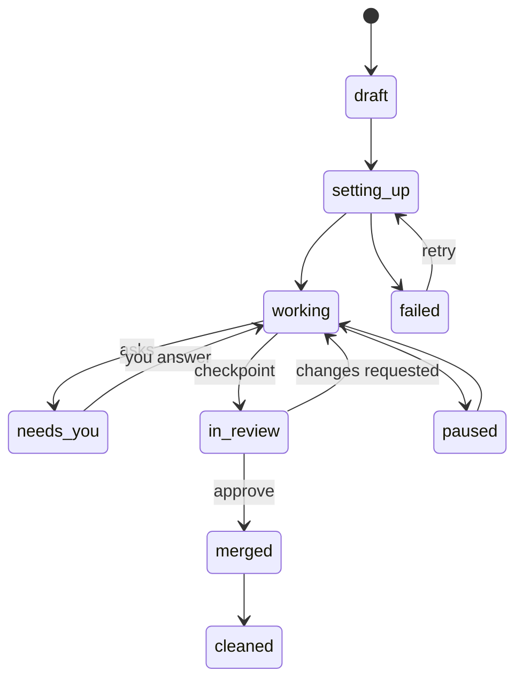

# ContextLanes — architecture

ContextLanes is one small service on an always-on machine. It turns a task into a **lane**: a branch and worktree, a terminal, a running copy of the app and an agent session. It carries that lane through to a merged change. Everything hard is borrowed: agents speak ACP, shells are tmux, apps run as systemd units, code is mapped by CodeGraph, and access rides on Tailscale.

## Processes

| Process | Lifetime | Job |
|---|---|---|
| Daemon (`apps/daemon`) | systemd user service | HTTP API, live stream, event log, lane manager, runtime, checker, notifier |
| Lane host (`apps/lanehost`) | one systemd unit per lane | Holds the agent's ACP session; survives daemon restarts |
| Agent | child of the lane host | Claude Code, Codex, OpenCode… each with its own login |
| Toolbox (`packages/toolbox`) | started by the agent over MCP stdio | Lets the agent use the lane: services, logs, previews, ask the owner, checkpoint, briefs, delegate |
| tmux session | one per lane | Your shell in the worktree; never the agent's |
| App services | systemd units per lane | The lane's running copy of the app, on its own ports |

## Data

Six tables in SQLite (`node:sqlite`, WAL). Everything else is a query over `event`.

| Table | Holds |
|---|---|
| `project` | A repo on this machine: path, remote, approved recipe hash |
| `lane` | One task in one worktree: agent, model, mode, branch, worktree, tmux session, state, colour |
| `event` | Every update in order, `(lane, seq)` gap-free |
| `checkpoint` | A change ready for review: base, head, checks, screenshots, decision |
| `environment` | A lane's running services: units, ports, hostnames, health |
| `approval` | Recipes approved by the owner, by hash |

### Lane lifecycle

A lane waits on you only in `needs_you` and `in_review`. `archived` can be reached from any open state.

### Events

| Type | When |
|---|---|
| `lane.created`, `lane.state` | The lane manager creates or moves a lane |
| `agent.plan`, `agent.thought`, `agent.message` | ACP plan updates and streamed text, joined into one step per run |
| `tool.call`, `tool.update` | ACP tool calls with kind, title and files |
| `permission.requested`, `permission.answered` | An agent asks; you answer from web, phone, Telegram or CLI |
| `env.status`, `check.result`, `checkpoint.created` | Runtime and checker |
| `helper.delegated` | The local helper did work, with tokens saved |
| `usage` | Context window use reported by the agent |

## Interfaces

**HTTP** (loopback; Tailscale Serve in front):

| Route | Purpose |
|---|---|
| `GET /api/health` | Version and host |
| `GET /api/projects`, `POST /api/projects` | List and register repos |
| `GET /api/projects/:project/lanes` | Lanes in a project |
| `GET /api/projects/:project/stream` | Server-sent events for every lane in the project |
| `POST /api/lanes` | Start a lane |
| `GET /api/lanes/:project/:n/events?after=` | Event history |
| `POST /api/lanes/:project/:n/prompt` | Message the agent |
| `POST /api/lanes/:project/:n/cancel`, `/mode`, `/model` | Interrupt or change an agent setting; commands survive daemon restart |
| `GET /api/lanes/:project/:n/terminal` | WebSocket: attach a PTY tmux client; browser disconnect detaches only that client |
| `POST /api/lanes/:project/:n/tools/:tool` | Toolbox calls from the agent |
| `GET /api/inbox`, `POST /api/answers` | What waits on you, and your answer |

**Lane host socket** (`<data>/lanes.sock`, JSON lines):
- host → daemon: `{"hello":"<lane>"}`, then `{"eventId":"<uuid>","event":{"type":"...","payload":{...}}}`.
- daemon → host: `{"ready":true}`, durable `{"commandId":"<uuid>","command":{"kind":"prompt|answer|cancel|mode|model",...}}` and `{"ack":"<eventId>"}`.
- The host retains observations until acknowledged; `(lane, source_id)` deduplicates replay in SQLite without seq gaps. Commands are `agent.command` events, pending until `agent.command.result`. The surviving host suppresses repeated command IDs. Permission answers are validated against the outstanding request and recorded with their command in one transaction.
- Only the daemon writes owner decisions and commands. The socket is mode 0600; host observations cannot forge `permission.answered`, user messages or lane transitions. New permission events move the lane to `needs_you`; the final pending answer moves it back with a `lane.state` event.

`[lanes].launchHosts` defaults to true. `[agents.<name>]` overrides the ACP command, argument array and environment; `[lanes.host]` and `[lanes.toolbox]` override workspace entry points. Defaults use absolute Node/script paths, so systemd does not depend on package binaries being globally linked. The host reconnects while holding the same agent process and ACP session. Agent failures become events; the host does not restart the task automatically.

**Agent toolbox** (MCP): `env_status`, `env_start`, `get_logs`, `preview_url`, `ask_owner`, `checkpoint`, `get_brief`, `delegate`.

**CLI:** `status`, `lanes`, `lane start`, `term`, `inbox`, `answer`, `arch`, `setup`.

**Terminal wire:** browser messages are validated `TerminalInput` values: `{"type":"input","data":"..."}` or `{"type":"resize","cols":100,"rows":30}`. Output is raw UTF-8 terminal text. The server starts at 80×24 and xterm sends its fitted size on connection and resize (1–500 columns, 1–200 rows). Input messages are bounded; a slow browser is disconnected rather than buffering indefinitely. Reconnect attaches to the existing session; tmux copy mode retains older history. Terminal I/O does not mutate lane state or create agent events.

The native PTY module loads only inside `Runner.terminal`, when attachment is requested. Its build or load failures are contained by the terminal route and cannot prevent daemon startup.

## Security

- The daemon binds `127.0.0.1`. Remote access is Tailscale Serve, which adds `Tailscale-User-Login`; a login that is not the configured owner gets 403. Requests without the header are accepted only from loopback when `access.allowLocal` is on.
- Terminal upgrades run through the same identity checks. Browser origins must match the request host; non-local browser hostnames additionally require the configured owner's Tailscale identity. This rejects cross-origin shell access and DNS rebinding. Non-browser clients may omit Origin. Daemon configuration rejects other bind addresses; Vite development and preview also bind loopback.
- Agents never approve their own permissions or recipes. Answers come only through `/api/answers`.
- Previews are reachable on the tailnet only; nothing listens on `0.0.0.0`.
- Cleanup never deletes unpushed commits.

## Decisions

| Decision | Why |
|---|---|
| TypeScript everywhere | Every borrowed SDK has TypeScript (ACP, Claude Agent SDK, Codex SDK, CodeGraph, Playwright); one language for daemon, host, CLI and web |
| `node:sqlite` instead of a native database module | No extra native database dependency; same SQL. `better-sqlite3` can replace it behind `Store` if needed |
| ACP for every agent | One client for Claude Code, Codex, OpenCode and more; native SDKs only as a fallback |
| One lane host per lane under systemd | Agents survive daemon restarts and upgrades |
| tmux for terminals | Persistent, attachable from the browser and any terminal |
| Subdomain per lane service | Paths break single-page apps and hot reload |
| Local helper as an MCP tool | Works with subscription logins; Claude Code cannot route subagents to other providers |
