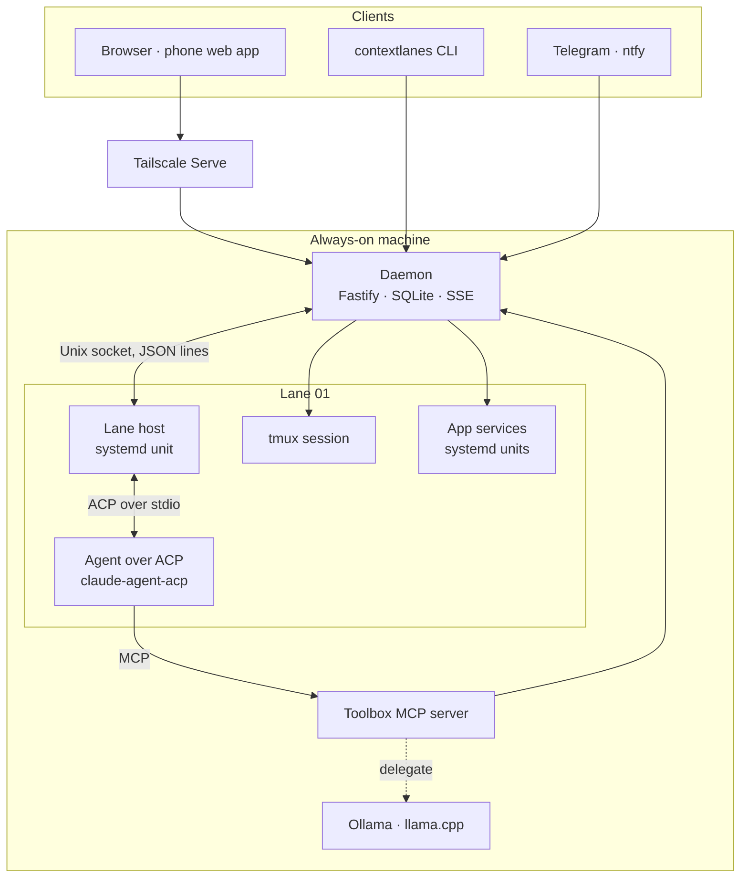
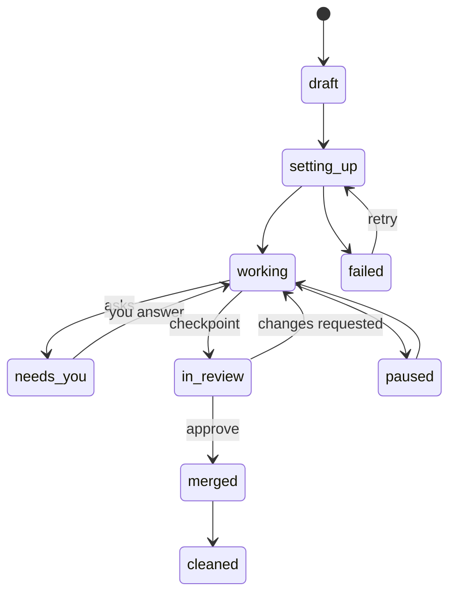

# ContextLanes — architecture

ContextLanes is one small service on an always-on machine. It turns a task into a **lane**: a branch and worktree, a terminal, a running copy of the app and an agent session. It carries that lane through to a merged change. Everything hard is borrowed: agents speak ACP, shells are tmux, apps run as systemd units, code is mapped by CodeGraph, and access rides on Tailscale.

## Processes

| Process | Lifetime | Job |
|---|---|---|
| Daemon (`apps/daemon`) | systemd user service | HTTP API, live stream, event log, lane manager, runtime, checker, notifier |
| Lane host (`apps/lanehost`) | one systemd unit per lane | Holds the agent's ACP session; survives daemon restarts |
| Agent | child of the lane host | Claude Code, Codex, OpenCode… each with its own login |
| Toolbox (`packages/toolbox`) | started by the agent over MCP stdio | Lets the agent use the lane: services, logs, previews, ask the owner, checkpoint, briefs, delegate |
| tmux session | one per lane | Your shell in the worktree; never the agent's |
| App services | systemd units per lane | The lane's running copy of the app, on its own ports |

## Data

The six core tables, three notification transport tables, hashed owner-session table and expiring setup-link table live in SQLite (`node:sqlite`, WAL). Lane state and work remain event-derived.

| Table | Holds |
|---|---|
| `project` | A repo on this machine: path, remote, approved recipe hash |
| `lane` | One task in one worktree: agent, model, mode, branch, worktree, tmux session, state, colour |
| `event` | Every update in order, `(lane, seq)` gap-free |
| `checkpoint` | A change ready for review: base, head, checks, screenshots, decision |
| `environment` | A lane's running services: units, ports, hostnames, health |
| `approval` | Recipes approved by the owner, by hash |
| `push_subscription` | Private browser push endpoints and encryption keys |
| `notification_action` | Hashed, single-choice notification capabilities |
| `notification_cursor` | Last processed Telegram polling offset |

### Lane lifecycle

A lane waits on you only in `needs_you` and `in_review`. `archived` can be reached from any open state.

### Events

| Type | When |
|---|---|
| `lane.created`, `lane.state` | The lane manager creates or moves a lane |
| `agent.plan`, `agent.thought`, `agent.message` | ACP plan updates and streamed text, joined into one step per run |
| `tool.call`, `tool.update` | ACP tool calls with kind, title and files |
| `permission.requested`, `permission.answered` | An agent asks; you answer from web, phone, Telegram or CLI |
| `recipe.requested`, `recipe.approved` | A lane needs a recipe approved; the owner approved it |
| `env.status`, `check.result`, `checkpoint.created`, `checkpoint.decided` | Runtime, checker and the owner's decision |
| `helper.delegated` | The local helper did work, with tokens saved |
| `usage` | Context window use reported by the agent |
| `agent.command`, `agent.command.result` | Durable owner controls and host acknowledgements |
| `agent.session`, `agent.turn`, `agent.error` | Reported settings, active prompt IDs and failures |
| `notification.sent`, `notification.failed` | Delivery evidence; never permission decisions |

## Interfaces

**HTTP** (loopback; Tailscale Serve in front):

| Route | Purpose |
|---|---|
| `GET /api/health` | Version and host |
| `GET /api/machine`, `POST /api/machine/updates`, `GET /api/data/export` | Machine/backup observations, fetch-only CLI update check, redacted JSON download |
| `GET /api/usage?project=&since=` | Per-lane and UTC-day token/cost totals, with reported agent limits |
| `POST /api/tickets` | A one-use, 30-second ticket for one stream or terminal path |
| `GET /api/projects`, `POST /api/projects` | List and register repos |
| `GET /api/projects/:project/lanes` | Lanes in a project |
| `GET /api/projects/:project/activity?since=` | Timeline events and preceding lifecycle/turn states |
| `GET /api/projects/:project/stream` | Server-sent events for every lane in the project |
| `POST /api/lanes` | Start a lane |
| `GET /api/lanes/:project/:n/events?after=` | Event history |
| `POST /api/lanes/:project/:n/prompt` | Message the agent |
| `POST /api/lanes/:project/:n/cancel`, `/mode`, `/model` | Interrupt or change an agent setting; commands survive daemon restart |
| `GET /api/lanes/:project/:n/terminal` | WebSocket: attach a PTY tmux client; browser disconnect detaches only that client |
| `POST /api/lanes/:project/:n/tools/:tool` | Toolbox calls from the agent |
| `GET /api/projects/:project/recipe`, `POST …/recipe/approve` | The project's recipe; approve by hash (owner session only) |
| `GET /api/projects/:project/environments` | Run page: recipes, environments and what can be cleaned up |
| `GET /api/lanes/:project/:n/env`, `POST …/env/start`, `/stop`, `/restart`, `GET …/logs` | A lane's services and journald logs |
| `POST /api/lanes/:project/:n/checkpoint` | Start the checker |
| `GET /api/projects/:project/checkpoints`, `GET /api/checkpoints/:id/shots/:file`, `GET /api/checkpoints/:id/diff` | Review packets |
| `POST /api/lanes/:project/:n/approve`, `/request-changes`, `/cleanup` | The owner's decisions (owner session only) |
| `GET /api/inbox`, `POST /api/answers` | What waits on you, and your answer |
| `GET /api/stream` | Global event stream for the Inbox |
| `GET /api/notifications` | Public notification configuration and VAPID public key, with no credentials |
| `POST /api/push/subscriptions`, `DELETE /api/push/subscriptions` | Register or remove this browser's push endpoint |

**Lane host socket** (`$XDG_RUNTIME_DIR/contextlanes-<hash>/lanes.sock`, JSON lines):
- host → daemon: `{"hello":"<lane>","token":"<lane token>"}`, then `{"eventId":"<uuid>","event":{"type":"...","payload":{...}}}`.
- daemon → host: `{"ready":true}`, durable `{"commandId":"<uuid>","command":{"kind":"prompt|answer|cancel|mode|model",...}}` and `{"ack":"<eventId>"}`.
- The host retains observations until acknowledged; `(lane, source_id)` deduplicates replay in SQLite without seq gaps. Commands are `agent.command` events, pending until `agent.command.result`. The surviving host suppresses repeated command IDs. Permission answers are validated against the outstanding request and recorded with their command in one transaction.
- Only the daemon writes owner decisions and commands. The socket is mode 0600; host observations cannot forge `permission.answered`, user messages or lane transitions. New permission events move the lane to `needs_you`; the final pending answer moves it back with a `lane.state` event.

`[lanes].launchHosts` defaults to true. `[agents.<name>]` overrides the ACP command, argument array and environment; `[lanes.host]` and `[lanes.toolbox]` override workspace entry points. Defaults use absolute Node/script paths, so systemd does not depend on package binaries being globally linked. The host reconnects while holding the same agent process and ACP session. Agent failures become events; the host does not restart the task automatically.

**Agent toolbox** (MCP): `env_status`, `env_start`, `get_logs`, `preview_url`, `ask_owner`, `checkpoint` are live; `get_brief` and `delegate` are declared for phase 3 and not given to agents (`LIVE_TOOLS`).

**CLI:** `status`, `lanes`, `lane start`, `term`, `inbox`, `answer`, `setup`, `add`, `update` (`arch` arrives with phase 3).

**Terminal wire:** browser messages are validated `TerminalInput` values: `{"type":"input","data":"..."}` or `{"type":"resize","cols":100,"rows":30}`. Output is raw UTF-8 terminal text. The server starts at 80×24 and xterm sends its fitted size on connection and resize (1–500 columns, 1–200 rows). Input messages are bounded; a slow browser is disconnected rather than buffering indefinitely. Reconnect attaches to the existing session; tmux copy mode retains older history. Terminal I/O does not mutate lane state or create agent events.

The native PTY module loads only inside `Runner.terminal`, when attachment is requested. Its build or load failures are contained by the terminal route and cannot prevent daemon startup.

## Security

- The daemon binds `127.0.0.1`, and Tailscale Serve proxies to it, so every request arrives from loopback. A local process can send any header, so loopback addresses, `Host` and Tailscale headers prove nothing. Only a credential says who a request is from: a browser session token (`Authorization: Bearer`, kept in localStorage), `<data>/setup-token` from the CLI, a single-use ticket for a stream or terminal, a lane token, or a notification action token. Every route except health, setup status and the sign-in routes answers 401 without one. A Tailscale login that is not the configured owner gets 403; the owner's login signs nobody in.
- Sessions are in localStorage because storage belongs to one host and port. A lane preview is the app's hostname on another port, and cookies would be sent to it; it cannot read this.
- A lane token is accepted only on that lane's toolbox routes and on its socket connection. Agents never approve their own permissions or recipes: answers come only through `/api/answers`, and recipe approval, merge, request changes and cleanup all need an owner credential.
- Every command started for a lane runs inside `bwrap` (`apps/daemon/src/sandbox.ts`), which hides the data folder except the releases, the config folder, all of `/run` and the tmux sockets. systemd's `InaccessiblePaths=` is not used: it has no effect in user units on Ubuntu 24.04, and could not leave the release readable. A lane does not start unless the sandbox is proven to hide `setup-token`.
- Limits: agents still run as the owner's Unix user, with write access to the home folder. They can edit dotfiles, `~/.ssh/authorized_keys` and git configuration, and the daemon's own git commands or the owner's next shell then run that outside the sandbox. They cannot read other lanes' process environments, or the daemon's, because each lane has its own user namespace. IMPLEMENTATION.md, Credentials and sandbox, has the full list.
- Terminal WebSockets also check that the browser origin matches the request host. Daemon configuration rejects other bind addresses; Vite development and preview also bind loopback.
- Notification action bearers grant exactly one recorded lane/request/option, not general API access. A conflicting Tailscale owner is still refused. Telegram callbacks additionally require the configured sender and chat. Replays cannot answer twice; no action expiration, quiet-hour timer or delivery retry supplies an answer. Push subscriptions and action hashes are private; database files use mode 0600.
- Previews are reachable on the tailnet only. Services are started on 127.0.0.1, and one found listening on another address is stopped by the next probe (every 5 seconds); the "before" services the checker starts for screenshots are short-lived and not probed.
- Cleanup refuses unpushed commits and uncommitted changes to tracked files, and nothing force-pushes. It does remove the checkout's ignored files (`.env`, local databases, build output) with it.

**Notifications:** the daemon observes pending request events, records `notification.sent` / `notification.failed`, and retries deferred work after quiet hours and on restart. ntfy and Telegram use injected HTTP fetch; Web Push uses an injected VAPID transport. Telegram polls outbound and persists its cursor; it never needs an inbound public bot webhook. Provider credentials remain in configuration and are excluded from public status routes.

## Setup and installation

The daemon serves the built `apps/web/dist` SPA as well as `/api`; unknown API routes never become HTML. Static paths are confined to that directory, assets are immutable and the service worker is not cached. Live event streams end during `preClose`, so a browser cannot hold a daemon restart open. Host startup refuses an active lane socket or non-socket path; only stale sockets are removed.

`SetupManager` writes validated configuration atomically with mode 0600, then applies it to the running managers. Saved projects are re-registered idempotently at startup, and notifier changes close the old transport before starting the new one. Commands remain injected through `Runner`, including agent status/install, Git validation and Tailscale Serve. Model probes are loopback-only and reject redirects.

The CLI proves local shell access by reading `<data>/setup-token` (0600) automatically and sends it on every request. The local control endpoint additionally requires a loopback peer and hostname and refuses Origin/Tailscale headers. It persists the shell owner, checks linger, enables/reuses Serve through Runner, then mints an origin-bound ten-minute sign-in link. Only link hashes are persisted; one atomic delete consumes a link, including under concurrent requests. Secrets are carried in URL fragments, removed on landing, and never sent in request URLs or referrers. Initial typed-code/passkey claim endpoints no longer exist. A shell owner is distinct from the optional Tailscale owner identity; no application API opens before one is established.

Browser setup steps are sign in, a Ready agent, an added project and a working lane. Repository discovery first reads Claude Code and Codex session history, then walks home five levels deep (at most 6,000 folders or 3 seconds), stopping at each repository and skipping hidden folders, node_modules, symlinks and folders with more than 300 subfolders. Folder browsing canonicalizes paths and confines them to home. Explicit path registration accepts `~`, verifies Git through Runner, and remains owner-only, as do scan/browse/branch and fixed-command login-terminal endpoints. Login terminals use the lazy native PTY bridge and never accept a shell command from a request. Closing one stops the login command, not any lane.

Passkeys can be added only to the owner’s configured HTTPS address after sign-in. WebAuthn uses single-use five-minute challenges bound to origin/RP, required user verification and persisted counters, which cannot move backwards. Thirty-day random session tokens are kept in the browser's localStorage; only hashes are stored. These authentication expirations never answer agent permissions. Existing passkeys remain valid at their original RP. Notification and local endpoint settings live in Settings and Models. Serve’s URL is persisted for notification links; existing routes are preserved.

`install.sh` bootstraps a new checkout, builds and invokes the installer entry point; on a machine that already has it, it builds the newest commit beside the running one and hands over to the updater. The installer writes an absolute-Node user unit and executable wrappers that point at `~/.local/share/contextlanes/current`; it replaces only files carrying its own marker line, refuses unrelated files and never stops lane hosts. `contextlanes update` builds each version in `releases/<commit>`, backs up the database, swaps the `current` link, restarts the daemon and switches back if the new version does not report healthy within 30 seconds (IMPLEMENTATION.md, Updating). Normal installation needs systemd user services, Node, npm, Git, tmux and bubblewrap. A failed optional native terminal build does not prevent the daemon from starting.

## Decisions

| Decision | Why |
|---|---|
| TypeScript everywhere | Every borrowed SDK has TypeScript (ACP, Claude Agent SDK, Codex SDK, CodeGraph, Playwright); one language for daemon, host, CLI and web |
| `node:sqlite` instead of a native database module | No extra native database dependency; same SQL. `better-sqlite3` can replace it behind `Store` if needed |
| ACP for every agent | One client for Claude Code, Codex, OpenCode and more; native SDKs only as a fallback |
| One lane host per lane under systemd | Agents survive daemon restarts and upgrades |
| tmux for terminals | Persistent, attachable from the browser and any terminal |
| Subdomain per lane service | Paths break single-page apps and hot reload |
| Local helper as an MCP tool | Works with subscription logins; Claude Code cannot route subagents to other providers |
